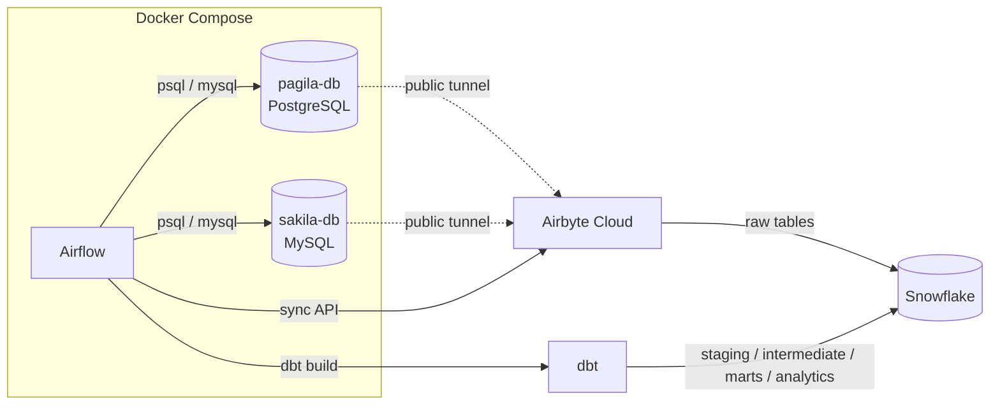

# SADA — Pagila and Sakila analytics platform

Small end-to-end data platform built around the Pagila and Sakila sample
databases:

- **Airflow** provisions both source databases from SQL dumps and orchestrates
  the pipeline.
- **Airbyte** replicates every table from both databases into Snowflake.
- **dbt** builds a layered model of the Pagila data and reproduces the
  analytical queries from the SQL assignment.

## Architecture



Layers inside Snowflake:

| Database | Schemas | Owner |
| --- | --- | --- |
| `SADA` | `PAGILA_RAW`, `SAKILA_RAW` | Airbyte (role `SADA_INGEST`) |
| `SADA` | `STAGING`, `INTERMEDIATE`, `MARTS`, `ANALYTICS` | dbt (through Airflow) |

## Project layout

```
airflow/            Airflow image, DAGs and runtime files
  dags/             DAG definitions
  Dockerfile        Airflow + psql/mysql clients + dbt virtualenv
airbyte/            Airbyte Cloud setup script (sources, destination, connections)
sources/            SQL dumps for the source databases
  pagila/           Pagila schema and data from sql_task_3 (the SQL assignment)
  sakila/           Sakila schema and data (official MySQL sample database)
snowflake/          One-time provisioning SQL
scripts/            Helper scripts (Snowflake bootstrap)
dbt/                dbt project: pagila_analytics
.env.example        Environment template (copy to .env; .env is git-ignored)
docker-compose.yml  Local stack: metadata DB, Pagila, Sakila and Airflow
```

## Prerequisites

- Docker Desktop.
- A Snowflake account.
- An Airbyte Cloud workspace with an API application (client id/secret).
- A public TCP tunnel to ports 5433 and 3307 while a sync runs (see
  "Exposing the source databases to Airbyte Cloud" below). Airbyte Cloud runs
  on Airbyte's infrastructure and cannot reach `localhost`.
- The Snowflake admin credentials for the one-time bootstrap step only.

## Setup

Steps 1, 2 and 4 are one-time; step 3 is repeated on every start; steps 5 and 6
are repeated on every new tunnel (the Airbyte configuration is idempotent).

1. Create the environment file and fill in the values:

   ```bash
   cp .env.example .env
   ```

   `SNOWFLAKE_*` is the admin account used once for provisioning.
   `AIRFLOW_SF_*` and `AIRBYTE_SF_*` are the least-privilege service users
   created by the bootstrap script. `AIRBYTE_*` holds the Cloud API settings.
   The Airflow login defaults to `airflow` / `airflow`.

2. Provision Snowflake (once, with an account that can assume
   `ACCOUNTADMIN`):

   ```bash
   python -m pip install snowflake-connector-python
   python scripts/bootstrap_snowflake.py
   ```

   Airflow never receives the admin credentials: it connects as
   `AIRFLOW_SVC` with the `SADA_DEV` role.

3. Start the local stack (repeat on every start):

   ```bash
   docker compose up -d --build
   ```

   The Airflow UI is available at <http://localhost:8080> using the
   `AIRFLOW_ADMIN_*` credentials from `.env`.

4. Enable TLS on Pagila (once per database volume). Airbyte Cloud uses the
   strict-encrypt connector variants, so the source must accept TLS. Run the
   commands **one at a time, in this order**; the `openssl` command is a single
   command wrapped over several lines only for readability (PowerShell does not
   use `\` for line continuation, so paste it as one line there):

   ```bash
   docker exec -u postgres sada-pagila-db bash -lc "openssl req -new -x509 -days 3650 -nodes -text -out /var/lib/postgresql/data/server.crt -keyout /var/lib/postgresql/data/server.key -subj '/CN=pagila'"
   docker exec -u root sada-pagila-db chmod 600 /var/lib/postgresql/data/server.key
   docker exec -u postgres sada-pagila-db psql -c "ALTER SYSTEM SET ssl = on;"
   docker compose restart pagila-db
   ```

   The order matters: the certificate and key are created in `PGDATA`, the key
   is made private, `ALTER SYSTEM` stores `ssl=on`, and the restart applies it.
   Confirm the result with:

   ```bash
   docker exec sada-pagila-db psql -U postgres -c "show ssl;"
   ```

   The output must be `on`. The certificate lives in the database volume and
   survives restarts; run the commands again if the volume is recreated. MySQL
   generates its own certificates on first start, so no extra step is needed
   there.

5. Open the two tunnels and put their public host/port into
   `PAGILA_SOURCE_*` and `SAKILA_SOURCE_*` in `.env`:

   ```bash
   ngrok tcp 5433
   ngrok tcp 3307
   ```

   See the next section for a portable way to do this on any machine. The
   databases are exposed while the tunnels are open, so close them after the
   replication run.

### Exposing the source databases to Airbyte Cloud

Airbyte Cloud runs on Airbyte's servers, so it cannot reach `localhost`. While
a sync runs, the databases must be reachable through a public TCP endpoint.
Any TCP tunnel works; two portable options:

- **ngrok** (free account and authtoken):

  ```bash
  ngrok config add-authtoken <token>
  ngrok tcp 5433
  ngrok tcp 3307
  ```

- **bore** (no account):

  ```bash
  bore local 5433 --to bore.pub
  bore local 3307 --to bore.pub
  ```

Copy the public host and port printed by the tool into `.env`:

```dotenv
PAGILA_SOURCE_HOST=...
PAGILA_SOURCE_PORT=...
SAKILA_SOURCE_HOST=...
SAKILA_SOURCE_PORT=...
```

The script checks TCP connectivity before creating or updating the sources, so
a closed tunnel fails immediately with a clear message instead of a slow sync
failure.

Free endpoints are ephemeral: after a tunnel restarts, update `.env` and rerun
the script. The tunnels are only needed for the Airbyte sync; close them when
the replication is finished.

6. Create the Airbyte Cloud sources, destination and connections (once, or
   again whenever the tunnel endpoints change; the script is idempotent):

   ```bash
   python airbyte/setup_airbyte.py
   ```

   The script checks TCP connectivity to both tunnels before creating or
   updating the sources and fails immediately if they are closed.

## Pipeline

| DAG | Purpose |
| --- | --- |
| `pagila_setup` | Recreates the Pagila schema and loads schema + data through `psql`. |
| `sakila_setup` | Recreates the Sakila database and loads schema + data through `mysql`. |
| `sada_replication` | Triggers the Airbyte connections, waits for them and verifies row counts. |
| `pagila_dbt_analytics` | Starts automatically on the `pagila_raw` asset; runs `dbt source freshness`, `dbt build` and the analytics checks. |

Run `pagila_setup` and `sakila_setup` first (or skip them when the source
databases already contain the data), then `sada_replication`. The replication
DAG publishes the `pagila_raw` asset, which triggers `pagila_dbt_analytics`
automatically; it can also be triggered by hand after a fresh sync. The setup
DAGs are idempotent: re-running them rebuilds the source database from the dump.

## dbt project

`dbt/pagila_analytics` contains the models behind `pagila_dbt_analytics`:

| Layer | Contents |
| --- | --- |
| staging | 15 typed views over the Airbyte raw tables |
| intermediate | film/actor bridge, rental facts, enriched customers |
| marts | `dim_film`, `dim_actor`, `dim_customer`, `dim_date`, `fact_rental`, `fact_revenue` |
| analytics | the seven queries from the SQL assignment |

Run the project inside the Airflow image:

```bash
docker compose exec airflow-scheduler bash -lc \
  "cd /opt/airflow/dbt/pagila_analytics && dbt build --profiles-dir . \
   --target-path /tmp/dbt-target --log-path /tmp/dbt-logs"
```

The `/tmp` paths keep the container's manifest separate from any artifacts a
local dbt run writes into `target/` on the host.

`dbt source freshness` checks the last Airbyte extraction, `dbt docs generate`
produces the documentation and lineage graph, and `dbt build` runs models and
tests together.

## Design decisions

- **TLS is enabled on the source databases.** Airbyte Cloud uses the
  strict-encrypt connector variants, so Pagila runs with a self-signed
  certificate and MySQL with its generated certificates.
- **`payment_p2015_*` is excluded from replication.** Those tables are
  inheritance children of `payment`; the parent already returns their rows.
  Replicating both would duplicate every payment.
- **Sakila stops at the raw layer.** The dbt requirements describe
  `pagila_analytics` only, so Sakila is replicated and verified but not
  modelled.
- **Three roles.** `SADA_INGEST` can only write the raw schemas, `SADA_DEV` can
  read the raw layer and manage the transformation schemas, `SADA_ADMIN` is a
  human role. Airflow and dbt run as `SADA_DEV`; the admin role is used only by
  the bootstrap script.
- **Materialisations.** Staging and intermediate models are views, marts are
  tables, analytics models are views. The marts are the persisted, reusable
  dimensional layer; the analytics models are the assignment queries and are
  always computed from the current marts.
- **No incremental models or snapshots.** The sample data is a static
  snapshot, so the extra machinery would not model a real ingestion pattern.
- **Freshness is about replication, not about the data itself.** The Pagila
  data is from 2005; `dbt source freshness` therefore measures when Airbyte
  last loaded the raw tables (`_airbyte_extracted_at`), not the age of the
  business data.
- **`dim_date` is generated.** Pagila has no calendar table, so the date
  dimension is built from a date spine covering 2000-01-01 to 2030-12-31.
- **Natural keys.** Dimension and fact tables keep the source identifiers
  (`film_id`, `customer_id`, ...) instead of hashed surrogate keys; there is no
  history to track and the identifiers stay readable in the warehouse.

## Verification

- Row counts in the source databases and in `SADA.PAGILA_RAW` /
  `SADA.SAKILA_RAW` must match.
- `SELECT CURRENT_ROLE()` from an Airflow Snowflake task must return
  `SADA_DEV`.
- `dbt source freshness` must pass for all 15 sources, and `dbt build` must
  pass (31 models, 55 tests).
- The analytics models must match the reference output from the SQL
  assignment (`sql_task_3/output/results.txt`).

## Notes

- The Snowflake warehouse is XSMALL and auto-suspends after 60 seconds to keep
  trial credits usage low.
- Airbyte Cloud is reached over the public internet, so the replication DAG
  needs the tunnels to be open. If a tunnel address changes, update
  `PAGILA_SOURCE_*` / `SAKILA_SOURCE_*` and run `airbyte/setup_airbyte.py`
  again.
- The tunnels expose the databases while they are open. The `airbyte_reader`
  users can only read, and their passwords are random, but the tunnels should
  be closed when the replication is finished.
- If the Docker engine becomes unresponsive under memory pressure, restart
  Docker Desktop. Container data lives in volumes and survives the restart.
- Source freshness is enforced: if the raw tables were last replicated more
  than 72 hours ago, `dbt_source_freshness` fails and the dbt DAG stops.
  Run `sada_replication` first, or run `dbt build` directly when only the
  models need to be rebuilt.
